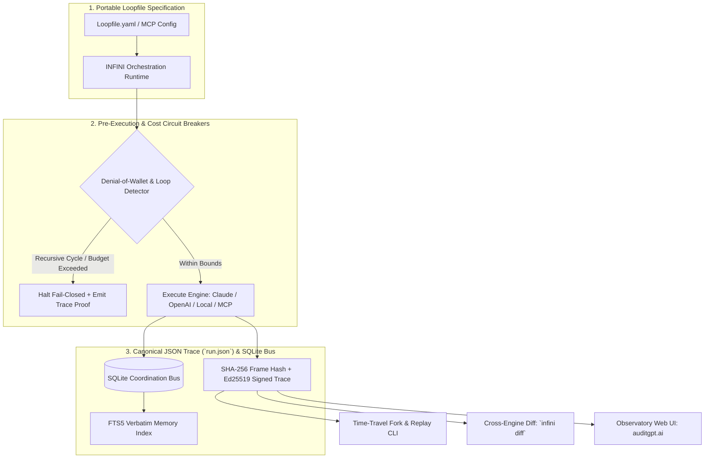

# INFINI

**Deterministic Agent Trace Runtime, SQLite Coordination Bus, and Cross-Engine Workflow Specification.**

[](https://github.com/NickAltstein/infini)
[](https://github.com/NickAltstein/infini/actions)
[](#deterministic-trace-format-runjson--sqlite-bus)
[](https://auditgpt.ai)
[](./LICENSE)

Autonomous agent workflows fail silently across non-deterministic LLM sampling, brittle MCP tool calls, and runaway recursive retry loops. Standard observability platforms treat agent traces as append-only cloud telemetry—requiring external Redis/Kafka clusters while offering zero local replayability or hard circuit breakers before token budgets are exhausted.

**INFINI** is a zero-dependency, portable agent execution standard (`Loopfile`) and **trace orchestration CLI**. It captures every prompt, MCP JSON-RPC 2.0 frame, filesystem mutation, and environment state into a signed, content-addressed JSON trace artifact (`run.json`)—enabling **zero-token time-travel debugging**, **cross-runtime execution diffing**, and **deterministic Denial-of-Wallet (DoW) circuit breaking**.

---

## Core Architecture



---

## Systems Engineering Guarantees

- **Zero-Infrastructure SQLite Bus & Deterministic Trace Logging**: Eliminates external vector databases and Redis dependencies. Inter-agent coordination and verbatim memory run on a local SQLite WAL bus (`~/.infini/infini.db`) with native FTS5 full-text indexing, while each execution compiles into a portable, content-addressed JSON trace (`run.json`) for instant replay and inspection.
- **Deterministic Time-Travel Forking (Zero Upstream LLM Tokens)**: Scrub to any historical step $T+N$ in a recorded `run.json` trace, mutate the tool response or policy constraint, and deterministically replay downstream assertions without re-invoking upstream LLM API calls.
- **Denial-of-Wallet (DoW) & Level 4 Loop Brakes**: Enforces hard budget circuit breakers (tokens, USD, wall-clock time), AST/hash cycle detection for repeated tool calls, per-step state persistence, and a **2-round stagnation brake** that halts execution fail-closed if two consecutive rounds discover nothing new.
- **Adversarial Honeypot & MCP Runtime Verification**: Ships with built-in MCP honeypot servers to test agent resilience against indirect prompt injection, poisoned tool descriptions, and unauthorized filesystem traversal prior to production deployment.

---

## Interactive Web Observatory & Blast-Radius Sandbox

Inspect live `.trace` state machines, test MCP policy gates, and fork execution timelines directly in your browser with zero local setup:

* **[Launch INFINI / Receiptd Observatory Sandbox → `auditgpt.ai`](https://auditgpt.ai)**

---

## Quickstart

### 1. Installation

```bash
# Install from source in an isolated virtual environment (Python 3.11+)
git clone https://github.com/NickAltstein/infini.git
cd infini
pip install -e ".[dev]"
```

### 2. Execute a Deterministic Loopfile with Trace Recording

```bash
# Run a multi-step agent workflow with strict token caps and signed trace output
infini run examples/mcp-code-audit.loop.yaml \
  --max-steps 15 \
  --max-cost-usd 0.50 \
  --output ./runs/run-001 \
  --sign
```

### 3. Time-Travel Replay & Cross-Runtime Diffing

```bash
# Replay from Step 4 using cached upstream state (0 LLM tokens consumed for Steps 0..3)
infini replay ./runs/run-001/run.json --from-step 4

# Compare behavioral divergence, latency, and token burn across two model engines
infini diff ./runs/claude-sonnet/run.json ./runs/gpt-4o/run.json --format table

# Inspect trace summary and verification checkpoints
infini inspect ./runs/run-001
```

---

## Verified Runtime Capabilities (v0.4 Specification)

| Subsystem | Capability | Implementation Detail | Status |
| :--- | :--- | :--- | :--- |
| **Execution Engines** | Multi-Provider Adapter Layer | Verified across Anthropic, OpenAI, Local Ollama, and Mock deterministic harnesses | Verified |
| **Trace Format** | Portable `run.json` Artifact | Canonical JSON execution trace with per-step inputs, outputs, status, and telemetry | Verified |
| **Coordination Bus** | SQLite WAL & FTS5 Memory | Local SQLite message bus (`tasks`, `messages`) and verbatim memory (`lessons`, `lessons_fts`) | Verified |
| **Cost & Loop Safety** | Level 4 Loop Brakes | Token/dollar budget caps, step timeouts, and a 2-round stagnation brake | Verified |
| **Security Testing** | Adversarial MCP Honeypot | Simulated vulnerable MCP endpoints to benchmark prompt-injection exfiltration | Verified |
| **CI/CD Integration** | `infini-guard` GitHub Action | Automated PR regression gate verifying trace assertions and cost thresholds | Verified |
| **Cryptographic Proof** | Signed `run.json` Bundles | SHA-256 frame hash-chaining + Receiptd Ed25519 signature verification | Verified |

---

## Denial-of-Wallet (DoW) & Level 4 Loop Brakes

Autonomous agents frequently enter degenerate states when a tool returns an ambiguous error, burning hundreds of dollars in recursive retries. INFINI's runtime supervisor evaluates deterministic circuit breakers before and during execution:

```yaml
# Loopfile.yaml — Deterministic Circuit Breaker Configuration
version: "0.4"
name: "production-migration-agent"
limits:
  max_iterations: 12
  max_cost_usd: 1.25
  max_wall_clock_seconds: 90
cycle_detection:
  max_identical_tool_calls: 2        # Halt if identical (tool_name + canonical_args_sha256) repeats > 2x
  max_consecutive_tool_errors: 3      # Halt fail-closed on repeated non-zero exit codes or SQL exceptions
  stagnation_limit: 2                 # 2-round stagnation brake: halt if 2 consecutive rounds find nothing new
assertions:
  - type: "no_honeypot_trigger"
  - type: "filesystem_diff_within"
    allowed_paths: ["./migrations/**", "./tests/**"]
  - type: "cost_under_usd"
    threshold: 1.00
```

When a threshold or the 2-round stagnation limit is breached, INFINI terminates immediately, writes a signed failure receipt to `run.json`, and exits with a non-zero status code for CI visibility.

---

## Deterministic Trace Format (`run.json`) & SQLite Bus

Every run emits a canonical `run.json` trace inspectable via `infini inspect <run_dir>` or standard JSON tooling:

- **`engine` / `loopfile`**: Execution metadata, engine type, iteration count, and timestamps.
- **`steps`**: Sequential step frames (`id`, `name`, `status`, `cost`, `tokens_in`, `tokens_out`, tool executions).
- **`budget` & `brakes`**: Cumulative USD/token telemetry and tripped circuit breakers (including the 2-round stagnation brake).
- **`verifications`**: Check results, confidence scores, and contract assertion verdicts.
- **`provenance`**: SHA-256 frame hash-chaining and Ed25519 cryptographic signature when run with `--sign`.

Inter-agent coordination and persistent memory use a local SQLite WAL database (`~/.infini/infini.db`):
- **`tasks`**: Manager assigns, workers claim.
- **`messages`**: Agent-to-agent communication bus.
- **`lessons` & `lessons_fts`**: Verbatim memory with native SQLite FTS5 full-text indexing for sub-millisecond retrieval.

---

## CI/CD Regression Gate (`infini-guard`)

Enforce deterministic agent behavior and token budgets on every Pull Request:

```yaml
# .github/workflows/infini-guard.yml
name: INFINI Deterministic Agent Audit
on: [push, pull_request]

jobs:
  verify-agent-traces:
    runs-on: ubuntu-latest
    steps:
      - uses: actions/checkout@v4
      - uses: actions/setup-python@v5
        with:
          python-version: "3.11"
      - name: Install INFINI & Execute Deterministic Contract Suite
        run: |
          cd cli && pip install -e .
          pytest -q
```

---

## Repository Structure

```
infini/
├── cli/              # Reference engine, CLI (`run`, `replay`, `diff`, `inspect`, `ui`), and tests
│   ├── src/infini/   # Engine runtime, Loopfile parser, SQLite bus & loop brakes
│   └── tests/        # Pytest contract suite for replay determinism & loop brakes
├── loops/            # Example & domain Loopfiles
├── observatory-ui/   # Next.js interactive trace visualizer (auditgpt.ai)
└── spec/             # Loopfile specification & schema
```

---

## License

MIT © [Nick Altstein](https://github.com/NickAltstein)
