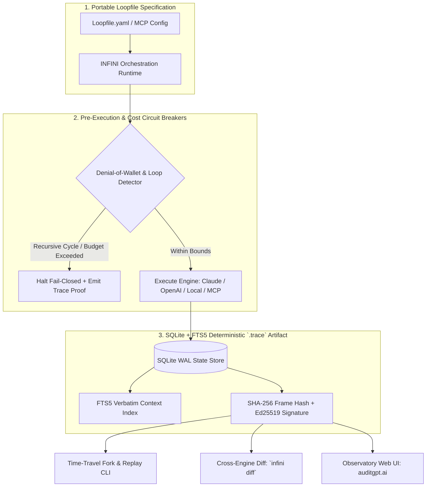

# INFINI

**Deterministic Agent Trace Runtime, SQLite + FTS5 Time-Travel Replay CLI, and Cross-Engine Workflow Specification.**

[](https://github.com/NickAltstein/infini)
[](https://github.com/NickAltstein/infini/actions)
[](#sqlite--fts5-trace-architecture)
[](https://auditgpt.ai)
[](./LICENSE)

Autonomous agent workflows fail silently across non-deterministic LLM sampling, brittle MCP tool calls, and runaway recursive retry loops. Standard observability platforms treat agent traces as append-only cloud telemetry—requiring external Redis/Kafka clusters while offering zero local replayability or hard circuit breakers before token budgets are exhausted.

**INFINI** is a zero-dependency, portable agent execution standard (`Loopfile`) and **SQLite-backed trace orchestration CLI**. It captures every prompt, MCP JSON-RPC 2.0 frame, filesystem mutation, and environment state into a signed, content-addressed `.trace` artifact—enabling **zero-token time-travel debugging**, **cross-runtime execution diffing**, and **deterministic Denial-of-Wallet (DoW) circuit breaking**.

---

## Core Architecture



---

## Systems Engineering Guarantees

- **Zero-Infrastructure SQLite + FTS5 Persistence**: Eliminates external vector databases and Redis state dependencies. Every execution trace compiles into a single portable SQLite WAL database (`*.trace`) indexed with SQLite FTS5 for sub-millisecond verbatim retrieval across tool outputs, stdout/stderr streams, and prompt contexts.
- **Deterministic Time-Travel Forking (Zero Upstream LLM Tokens)**: Scrub to any historical step $T+N$ in a recorded `.trace` ledger, mutate the tool response or policy constraint, and deterministically replay downstream assertions without re-invoking upstream LLM API calls.
- **Denial-of-Wallet (DoW) & Cyclic Loop Analysis**: Detects degenerate semantic retry loops (e.g., an agent repeatedly calling a failing linter or rate-limited endpoint), tracks cumulative token/cost velocity per frame, and enforces hard pre-execution budget circuit breakers.
- **Adversarial Honeypot & MCP Runtime Verification**: Ships with built-in MCP honeypot servers to test agent resilience against indirect prompt injection, poisoned tool descriptions, and unauthorized filesystem traversal prior to production deployment.

---

## Interactive Web Observatory & Blast-Radius Sandbox

Inspect live `.trace` state machines, test MCP policy gates, and fork execution timelines directly in your browser with zero local setup:

* **[Launch INFINI / Receiptd Observatory Sandbox → `auditgpt.ai`](https://auditgpt.ai)**

---

## Quickstart

### 1. Installation

```bash
# Install from source in an isolated virtual environment (Python 3.11+)
git clone https://github.com/NickAltstein/infini.git
cd infini
pip install -e ".[dev]"
```

### 2. Execute a Deterministic Loopfile with Trace Recording

```bash
# Run a multi-step agent workflow with strict token caps and signed SQLite trace output
infini run examples/mcp-code-audit.loop.yaml \
  --max-steps 15 \
  --max-cost-usd 0.50 \
  --trace-out ./traces/run-001.trace \
  --sign
```

### 3. Time-Travel Replay & Cross-Runtime Diffing

```bash
# Replay from Step 4 using cached upstream state (0 LLM tokens consumed for Steps 0..3)
infini replay ./traces/run-001.trace --from-step 4

# Compare behavioral divergence, latency, and token burn across two model engines
infini diff ./traces/claude-sonnet.trace ./traces/gpt-4o.trace --format table

# Search across 10,000+ historical tool frames in <2ms via SQLite FTS5
infini search ./traces/run-001.trace "SELECT * FROM customer_settlements"
```

---

## Verified Runtime Capabilities (v0.4 Specification)

| Subsystem | Capability | Implementation Detail | Status |
| :--- | :--- | :--- | :--- |
| **Execution Engines** | Multi-Provider Adapter Layer | Verified across Anthropic, OpenAI, Local Ollama, and Mock deterministic harnesses | Verified |
| **State Storage** | Portable `.trace` SQLite Ledger | Single-file SQLite WAL schema with full JSON-RPC 2.0 frame serialization | Verified |
| **Context Retrieval** | Verbatim Full-Text Search | Native SQLite FTS5 virtual tables indexing tool inputs, outputs, and agent reasoning | Verified |
| **Cost & Loop Safety** | Denial-of-Wallet (DoW) Engine | AST/hash cycle detection for identical tool calls + hard USD/token ceiling gates | Verified |
| **Security Testing** | Adversarial MCP Honeypot | Simulated vulnerable MCP endpoints to benchmark prompt-injection exfiltration | Verified |
| **CI/CD Integration** | `infini-guard` GitHub Action | Automated PR regression gate verifying trace assertions and cost thresholds | Verified |
| **Cryptographic Proof** | Signed `.trace` Bundles | SHA-256 hash-chaining across execution frames + Receiptd Ed25519 receipt compatibility | Verified |

---

## Denial-of-Wallet (DoW) & Loop Detection Specification

Autonomous agents frequently enter degenerate states when a tool returns an ambiguous error, burning hundreds of dollars in recursive retries. INFINI's runtime supervisor evaluates three deterministic invariants before permitting step $T+1$:

```yaml
# Loopfile.yaml — Deterministic Circuit Breaker Configuration
version: "0.4"
name: "production-migration-agent"
limits:
  max_iterations: 12
  max_cost_usd: 1.25
  max_wall_clock_seconds: 90
cycle_detection:
  max_identical_tool_calls: 2        # Halt if identical (tool_name + canonical_args_sha256) repeats > 2x
  max_consecutive_tool_errors: 3      # Halt fail-closed on repeated non-zero exit codes or SQL exceptions
assertions:
  - type: "no_honeypot_trigger"
  - type: "filesystem_diff_within"
    allowed_paths: ["./migrations/**", "./tests/**"]
  - type: "cost_under_usd"
    threshold: 1.00
```

When a threshold is breached, INFINI terminates the child process immediately, writes a `TERMINATED_DOW_POLICY` frame to the SQLite ledger, and exits with a non-zero status code for CI visibility.

---

## SQLite + FTS5 `.trace` Schema Overview

Every `.trace` file is a standard SQLite database inspectable via `infini inspect` or standard SQLite clients (`sqlite3 run.trace`):

- **`runs`**: Execution metadata, Loopfile SHA-256 digest, engine config, cumulative token/USD telemetry, and root cryptographic signature.
- **`frames`**: Sequential step records (`step_idx`, `timestamp_ns`, `frame_type`, `mcp_tool_name`, `canonical_args_json`, `output_json`, `latency_ms`, `tokens_in`, `tokens_out`, `frame_sha256`, `prev_frame_sha256`).
- **`frames_fts`**: SQLite FTS5 virtual index over `canonical_args_json`, `output_json`, and `reasoning_text` for instant offline grep and forensic auditing.
- **`assertions`**: Pass/fail contract evaluation results for filesystem state, exit codes, and security invariants.

---

## CI/CD Regression Gate (`infini-guard`)

Enforce deterministic agent behavior and token budgets on every Pull Request:

```yaml
# .github/workflows/infini-guard.yml
name: INFINI Deterministic Agent Audit
on: [push, pull_request]

jobs:
  verify-agent-traces:
    runs-on: ubuntu-latest
    steps:
      - uses: actions/checkout@v4
      - uses: actions/setup-python@v5
        with:
          python-version: "3.12"
      - name: Install INFINI & Execute Deterministic Contract Suite
        run: |
          pip install -e ".[dev]"
          pytest -q
          infini verify-traces ./tests/fixtures/traces/ --strict
```

---

## Repository Structure

```
infini/
├── infini/
│   ├── cli/          # Click/Typer CLI (`run`, `replay`, `diff`, `search`, `verify`)
│   ├── runtime/      # Loopfile parser, engine adapters & DoW circuit breakers
│   ├── storage/      # SQLite WAL state manager & FTS5 full-text indexing
│   ├── security/     # Signed `.trace` hashing & MCP adversarial honeypot servers
│   └── guard/        # CI assertion evaluator & regression diffing engine
├── observatory-ui/   # Next.js / Tailwind interactive trace & blast-radius visualizer (auditgpt.ai)
├── examples/         # Reference Loopfiles, honeypot evaluations & DoW benchmarks
└── tests/            # Pytest contract suite for replay determinism & cycle detection
```

---

## License

MIT © [Nick Altstein](https://github.com/NickAltstein)
